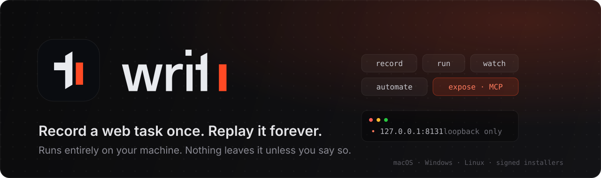

<div align="center">
  

  <br/>

  <p align="center">
    <a href="https://github.com/usewrit/writ-desktop/releases/latest"></a>
    <a href="./LICENSE"></a>
    
    
    
    
    
  </p>

  <h3 align="center">Record a web task once. Replay it forever — on your own machine.</h3>
  <p align="center">Turn any website into a workflow, a REST API, or an MCP tool your AI assistant can call.</p>

  <p align="center">
    <a href="#install"><b>Install</b></a> ·
    <a href="#what-it-does"><b>What it does</b></a> ·
    <a href="#connect-your-ai-mcp"><b>Connect your AI</b></a> ·
    <a href="./docs/TROUBLESHOOTING.md"><b>Troubleshooting</b></a> ·
    <a href="./SECURITY.md"><b>Security</b></a> ·
    <a href="https://github.com/usewrit/writ-desktop/issues"><b>Report a bug</b></a>
  </p>
</div>

---

**Writ Desktop** records a repeatable browser task once and replays it forever — no
re-scraping, no brittle scripts, no per-run AI cost. It is a desktop app: the engine runs
on your machine as a loopback-only background process, your workflows and credentials
stay in an encrypted database in your home directory, and nothing leaves the machine
unless you explicitly link a cloud account.

> **This repository is the download and issue tracker for the app.** Writ Desktop is
> proprietary and its source is not published here — see [`LICENSE`](./LICENSE). The
> engine the app drives, the self-hosted server, and the client SDKs *are* open source
> and live in their own repositories — see [Open source](#open-source) below.

## Install

Grab the installer for your platform from the
**[latest release](https://github.com/usewrit/writ-desktop/releases/latest)**.

| Platform | File | Notes |
|---|---|---|
| macOS (Apple silicon) | `.dmg` | macOS 11 Big Sur or newer, signed and notarized |
| macOS (Intel) | `.dmg` | macOS 11 Big Sur or newer, signed and notarized |
| Windows (x64) | `.msi` / `.exe` | Windows 10 or newer — **not yet code-signed**, see below |
| Linux (x86_64) | `.deb` / `.AppImage` | glibc 2.35 or newer (Ubuntu 22.04 and equivalents) |
| Linux (arm64) | `.deb` / `.AppImage` | glibc 2.35 or newer |

> **Windows shows a SmartScreen warning.** The Windows build is not yet
> Authenticode-signed, so Windows will say *"Windows protected your PC — unknown
> publisher"*. Choose **More info → Run anyway**. This is the honest state of the build,
> not a step you should get used to skipping: verify the download against `SHA256SUMS`
> below before you run it. Signing is coming; until it does, this page will keep saying so.

Every release ships a `SHA256SUMS` file. On Windows it is the only integrity check
available to you, so it is worth the ten seconds:

```bash
shasum -a 256 -c SHA256SUMS --ignore-missing
```

Full instructions, including what the first launch downloads and how to install
without an internet connection, are in [`docs/INSTALL.md`](./docs/INSTALL.md).

The app updates itself. Each update's manifest is signature-checked against a key
compiled into the application before anything is installed, and an update that does not
verify is refused. You can turn automatic updates off, or point a managed fleet at an
internal feed — see [`docs/AUTO_UPDATE.md`](./docs/AUTO_UPDATE.md).

## What it does

**Record a workflow.** Drive a real browser inside the app. Every click, type, and
navigation lands as an editable step. Replay it whenever you like — the same result every
time, at zero AI-token cost, because a replay executes the recorded steps rather than
asking a model to re-figure out the page.

**Call it like an API.** Every workflow is immediately callable three ways from your own
code, all on the loopback port with a local API key:

- `POST /v1/workflows/{id}/run` — REST, with start-and-poll or wait-for-result delivery
- an OpenAI-compatible base URL per workflow, for anything that already speaks that protocol
- `POST /mcp` — the workflow appears as an MCP tool

**Watch a page.** Point a monitor at a URL or a selector and get told when it changes.
Checks run on a schedule from your own machine.

**Chain it into automations.** Trigger on a change, a schedule, a webhook, or another
workflow finishing. Send the result to a connector, a file, or the next workflow.

**Crawl a site.** Point it at a domain and let it harvest pages into structured data,
including PDFs and scanned documents.

## Connect your AI (MCP)

Writ Desktop runs a local MCP server, so an assistant can call your workflows as tools.
The app writes the config for you — **Settings → MCP & APIs**, pick your client, click
install. Claude Desktop, Claude Code, ChatGPT desktop, and Codex are one-click; anything
else that speaks MCP can point at the same local endpoint.

Your assistant then gets your recorded workflows as callable tools, running locally,
with no key to paste and no page for the model to re-interpret.

## Where your data lives

| Thing | Where |
|---|---|
| Workflows, runs, results | encrypted SQLite database under `~/.writ` |
| Credentials and secrets | OS keyring where available, encrypted vault otherwise |
| The engine | a background process bound to `127.0.0.1` only |
| Cloud | nothing, unless you link an account |

[`SECURITY.md`](./SECURITY.md) is the authoritative statement of what is protected and —
just as importantly — what is **not** claimed. It is deliberately narrower than most
security pages. Nothing in this README should be read as exceeding it.

## Open source

Writ Desktop is proprietary, but it is built on projects that are not:

| Project | What it is |
|---|---|
| [`usewrit/writ-agent`](https://github.com/usewrit/writ-agent) | the Rust engine the app drives — the same binary ships inside the app |
| [`usewrit/writ`](https://github.com/usewrit/writ) | the self-hosted coordinator: `docker compose up` and run the whole thing on your own server |
| [`usewrit/writ-sdks`](https://github.com/usewrit/writ-sdks) | Python, TypeScript, Rust, and Go clients |
| [`writ-mcp`](https://www.npmjs.com/package/writ-mcp) | the MCP connector, on npm |

Every open-source component bundled in the app is listed with its full licence text in
[`THIRD_PARTY_NOTICES.md`](./THIRD_PARTY_NOTICES.md), which is regenerated from the
dependency graph on every release and also readable inside the app under
**Settings → About → Open-source licences**.

## Support

- **Bug or crash** → [open an issue](https://github.com/usewrit/writ-desktop/issues/new/choose).
  Include your version (**Settings → About**), OS, and what you were doing.
- **Security vulnerability** → do **not** open a public issue. Follow [`SECURITY.md`](./SECURITY.md).
- **Everything else** → support@usewrit.app

Release notes for every version are in [`CHANGELOG.md`](./CHANGELOG.md).
